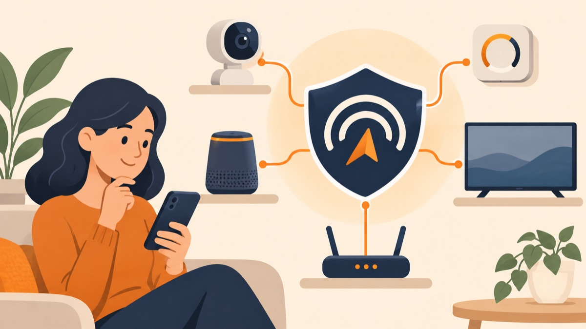

# Good Signal

### Know what your smart devices share—and what you can control.

Good Signal is a local-first guide to reviewing privacy settings across a connected home. It brings practical checklists, personal notes, and guide updates together so you can see what you’ve reviewed and what still needs attention.

**Explore device guides. Record your choices. Revisit what matters.**

## What you can do

- **Find relevant guidance.** Browse guides for 12 smart-device categories, from TVs and speakers to routers, cameras, and connected appliances.
- **Keep track of your review.** Record choices, notes, and questions to check later.
- **Pick up where you left off.** Your progress stays in your browser, including offline after preparing the app.
- **Notice what changed.** Review updates when a guide is revised.
- **Keep your notes on your device.** Good Signal has no account, ads, analytics, or cloud sync. Your device list, checklist progress, and notes are not sent to Good Signal.

## A straightforward review flow

1. Choose a guide for a device category.
2. Review the topics that apply, such as voice controls, data sharing, app permissions, and software updates.
3. Record the settings you checked, your choices, and anything you want to revisit.
4. Return later to continue your review or check for guide updates.

## Try Good Signal

Open [Good Signal](https://boredpolymath.github.io/GoodSignal/) in your browser. On supported browsers, you can add it to your Home Screen or install it from the browser menu. Install options vary by device and browser.

To report an outdated or incorrect guide, use **Report an outdated or incorrect guide** on a guide page. Good Signal prepares the report on your device so you can download or share it; it does not send reports automatically.

## Designed for practical reviews

Good Signal’s checklists offer general guidance for device categories. They are not verified for every make, model, region, or software version. The app does not scan or control your devices, and completing a checklist is not a privacy or security certification. Check your device’s current manual and settings when making changes.

## Your data, in your browser

Good Signal does not require an account. Your device list, checklist progress, and notes stay in browser storage on your device and are not synced to a server. The hosting service receives ordinary requests for app files, but not your saved checklist information. Browser storage can be cleared or evicted, so keep any notes you need elsewhere. Local storage is not an enterprise access-control or encryption system; use care on shared devices.

## Contributing and support

See [CONTRIBUTING.md](CONTRIBUTING.md) for development and pull request guidance. For help, issue reports, and guide corrections, see [SUPPORT.md](SUPPORT.md). Please read the [Code of Conduct](CODE_OF_CONDUCT.md) before participating. Security researchers can find private reporting guidance in [SECURITY.md](SECURITY.md). Good Signal is released under the [MIT License](LICENSE).
